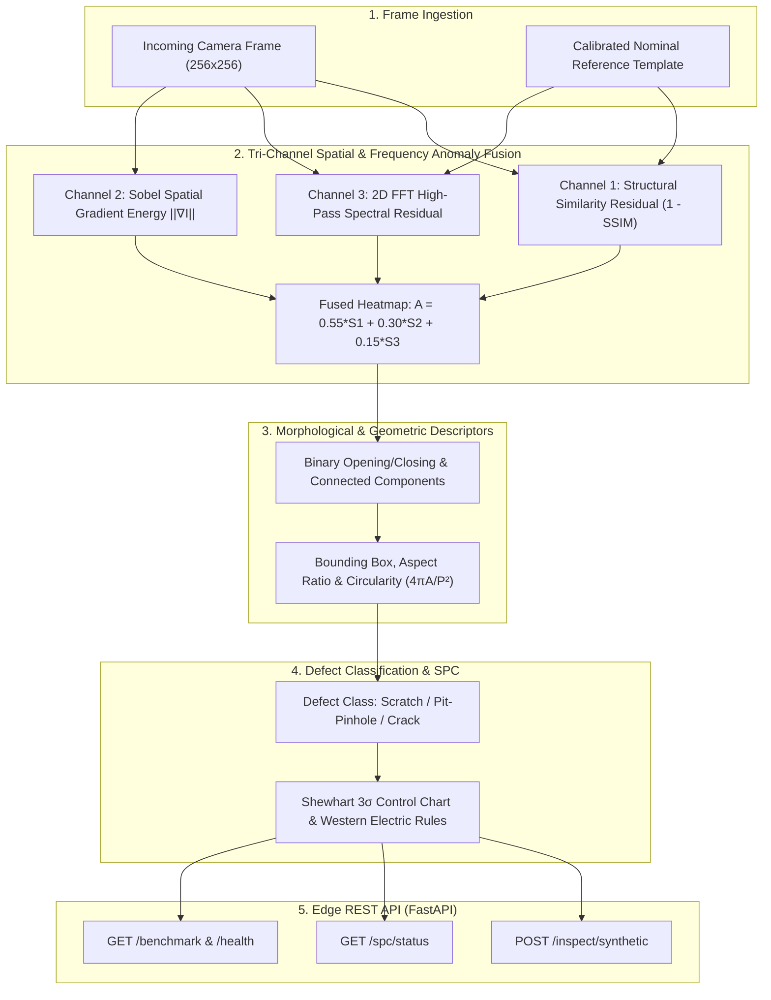

# Industrial Edge Defect Inspection, 2D FFT Spectral Vision & SPC Engine

[](https://github.com/yakupakcy36/industrial-edge-defect-inspection/actions)
[](https://www.python.org/downloads/)
[](https://fastapi.tiangolo.com/)
[](https://opensource.org/licenses/MIT)

An ultra-low latency Automated Optical Inspection (AOI) edge vision engine for **real-time manufacturing surface defect detection, 2D Fast Fourier Transform (FFT) spectral residual filtering, morphological shape descriptor analysis, and Shewhart / Western Electric Statistical Process Control (SPC)**.

Engineered for inline industrial edge computers (IPC, Jetson, Raspberry Pi) operating at 100+ FPS without cloud dependencies or external API costs.

---

## 🏛️ Vision & SPC Pipeline Architecture



---

## 🔬 Mathematical Formulations

### 1. 2D Fast Fourier Transform (FFT) Spectral Residual
Periodic rolling lines on brushed metal surfaces create false alarms in naive spatial detectors. Transforming the frame difference $\Delta I = I - I_{\text{ref}}$ into the 2D frequency domain attenuates low-frequency illumination and isolates non-periodic localized anomalies:

$$\mathcal{F}(\Delta I)(u, v) = \sum_{x=0}^{H-1} \sum_{y=0}^{W-1} \Delta I(x, y) \, e^{-i 2\pi \left(\frac{ux}{H} + \frac{vy}{W}\right)}$$

$$R_{\text{FFT}}(x, y) = \left| \mathcal{F}^{-1} \Big( H_{\text{HP}}(u, v) \cdot \mathcal{F}(\Delta I)(u, v) \Big) \right|$$

### 2. Morphological Circularity & Aspect Ratio
Connected defect components are characterized by their bounding box aspect ratio and isoperimetric circularity quotient:

$$\text{Circularity} = \frac{4\pi \cdot \text{Area}}{\text{Perimeter}^2} \in (0, 1], \qquad \text{Aspect Ratio} = \frac{\max(H, W)}{\min(H, W)}$$

### 3. Statistical Process Control (SPC) & Western Electric Rules
Inline anomaly scores are monitored across a rolling window against Shewhart control limits:

$$\text{UCL}_{3\sigma} = \mu_0 + 3\sigma_0, \qquad \text{UCL}_{2\sigma} = \mu_0 + 2\sigma_0, \qquad \text{LCL}_{3\sigma} = \max(0, \mu_0 - 3\sigma_0)$$

* **Western Electric Rule 1:** Any single frame exceeding $\text{UCL}_{3\sigma}$ flags an immediate process excursion.
* **Western Electric Rule 2:** $2$ out of $3$ consecutive frames exceeding $\text{UCL}_{2\sigma}$ flags sustained process drift.

---

## 📁 Repository Structure

```text
industrial-edge-defect-inspection/
├── .github/workflows/ci.yml     # Automated GitHub Actions CI pipeline
├── src/
│   ├── config.py                # Frame dimensions, kernel sizes, thresholds
│   ├── generator.py             # Anisotropic brushed metal & defect synthesizer
│   ├── inspector.py             # SSIM + Sobel + 2D FFT fusion & shape analyzer
│   └── spc.py                   # Shewhart 3σ & Western Electric SPC monitor
├── api/
│   ├── schemas.py               # Pydantic v2 schemas
│   └── app.py                   # FastAPI edge server (/inspect, /spc/status, /benchmark)
├── tests/                       # Comprehensive unit & integration test suite
├── Dockerfile                   # Container definition
├── docker-compose.yml           # Local service orchestration
└── requirements.txt
```

---

## 🚀 Quickstart & Reproduction

```bash
# 1. Install dependencies
pip install -r requirements.txt

# 2. Execute test suite
pytest -v

# 3. Launch edge API
uvicorn api.app:app --host 0.0.0.0 --port 8000
```

---

## 📡 API Reference

* **`POST /inspect/synthetic`**: Evaluates a frame and returns anomaly score, 2D FFT spectral energy, defect severity, and bounding boxes with `aspect_ratio` and `circularity`.
* **`GET /spc/status`**: Returns rolling first-pass yield percentage, $\text{UCL}_{3\sigma}$, and active Western Electric rule violations.
* **`GET /benchmark`**: Evaluates continuous frame latency and throughput FPS.

---

## 📄 License
MIT License.
